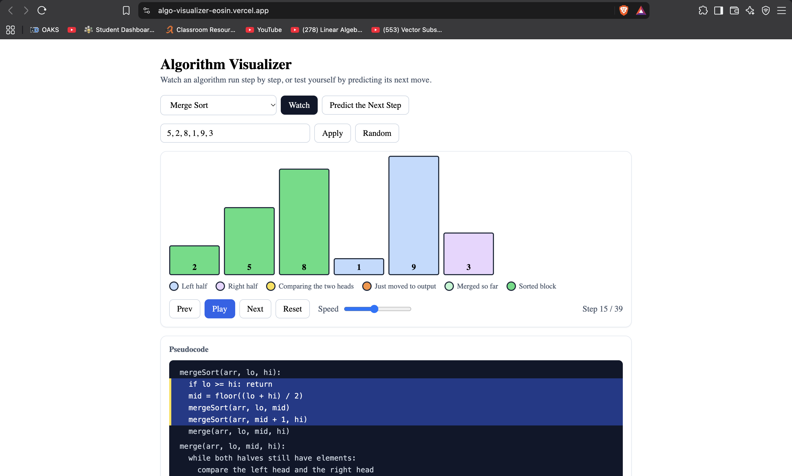

# Algorithm Visualizer

An interactive website that shows algorithms running step by step, and lets you test yourself with a **"Predict the Next Step"** quiz mode.

**Live demo:** https://algo-visualizer-eosin.vercel.app


## Features

- **Watch mode:** Play, Pause, Prev, Next, Reset and a speed slider.
- **Predict the Next Step:** the visualization pauses and asks what the algorithm will do next (click a node, choose Swap or Don't swap, Left or Right, and so on). Your score is tracked.
- **Live pseudocode:** the lines being executed are highlighted as the algorithm runs.
- **Complexity panel:** best, average, worst and space complexity for every algorithm.
- **Custom input:** type your own array (or press Random) for the sorting and searching algorithms, and set your own search target.



## Algorithms

| Category | Algorithms |
|---|---|
| Graph traversal | BFS, DFS |
| Shortest path | Dijkstra (weighted graph) |
| Sorting | Bubble Sort, Insertion Sort, Merge Sort |
| Searching | Binary Search |

## How it works

Every algorithm is written as a **step recorder**: instead of just returning the answer, it runs once and saves a snapshot after every important action (visiting a node, comparing two bars, updating a distance).

```js
[
  { type: "visit", node: 0, queue: [1, 2], visited: [0] },
  { type: "enqueue", node: 1, from: 0, queue: [1, 2], visited: [0, 1] },
  ...
]
```

The user interface only replays this list of steps. That design has three benefits:

1. **Logic and drawing are separate.** The algorithm files contain no React code, so adding a new algorithm means adding one recorder file, a pseudocode entry and one dropdown entry.
2. **Stepping backwards is free.** Prev just moves the index back.
3. **The quiz is simple.** At step `i`, the correct answer is already stored in step `i + 1`.

## Tech stack

- React 19 and Vite
- HTML Canvas for the graphs, plain CSS for the layout
- Deployed on Vercel

## Run it locally

```bash
git clone https://github.com/SourabhAM13107/algo-visualizer.git
cd algo-visualizer
npm install
npm run dev
```

Then open the link printed in the terminal (usually http://localhost:5173).

## Project structure

```
src/
  algorithms/   step recorders (bfs, dfs, dijkstra, bubbleSort, insertionSort, mergeSort, binarySearch)
  components/   drawing components, pseudocode panel, complexity panel
  data/         sample graphs, pseudocode text, complexity table
  hooks/        usePlayer (play, pause, step, speed)
  App.jsx       connects everything and runs the quiz logic
```

## Planned

- Quick Sort and more graph algorithms (Prim, Kruskal)
- Editable graphs (add and drag nodes and edges)
- Dark mode and a better phone layout